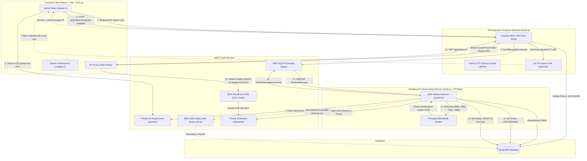
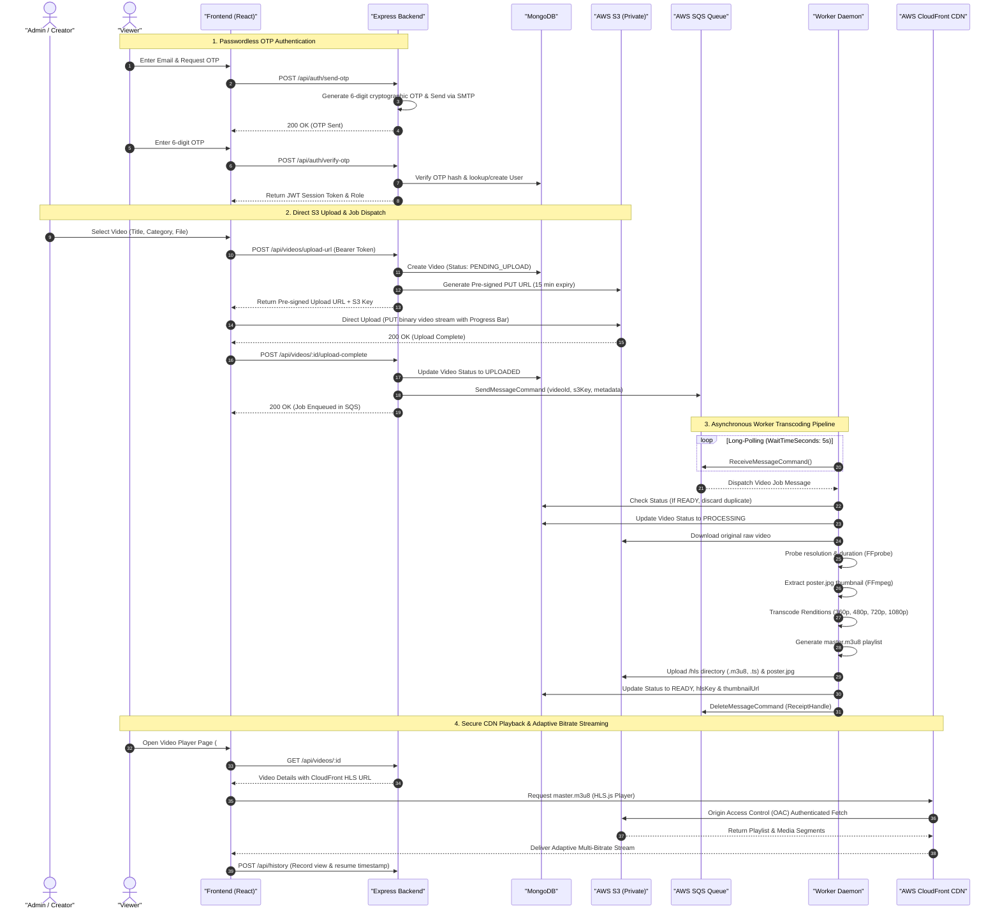

# 🎬 StreamCloud — Cloud Video Streaming Platform

StreamCloud is an enterprise-grade, cloud-native video streaming platform built with the MERN stack (MongoDB, Express, React, Node.js), **AWS S3**, **AWS SQS**, **AWS CloudFront (OAC)**, and **FFmpeg**.

It features direct-to-S3 high-speed uploads, asynchronous job queuing with Dead-Letter Queue (DLQ) retry policies, multi-bitrate HLS adaptive streaming (360p to 1080p), passwordless OTP authentication, playback progress tracking, and an administrative control suite.

---

## 🏗️ 1. End-to-End Processing Architecture



---

## 🔄 2. Application Flow Diagram (Sequence Flow)

The diagram below details the complete lifecycle of a video from ingest to CDN playback:



---

## ⚡ 3. Key Capabilities & Features

### 🚀 Direct-to-S3 Pre-signed Uploads
- Large video files upload directly from the user's browser to **AWS S3** using pre-signed S3 URLs.
- Web server memory, bandwidth, and CPU remain unblocked, supporting files up to 5 GB with live percentage progress tracking.

### 📬 Asynchronous SQS Processing & Dead-Letter Queue (DLQ)
- Once an S3 upload is confirmed, a message containing `videoId`, `s3Key`, and metadata is sent to **AWS SQS**.
- The worker daemon consumes jobs via long-polling (`WaitTimeSeconds: 5`, `VisibilityTimeout: 300s`).
- **Idempotency**: Duplicate messages for already `READY` videos are safely discarded.
- **DLQ Redrive Policy**: If a job fails more than 3 times (`MAX_RECEIVE_COUNT`), it is routed to the Dead-Letter Queue (`streamcloud-video-processing-dlq`), and the video document is updated to `FAILED`.

### 🎥 Multi-Bitrate HLS Transcoding
- **FFmpeg Pipeline**: Transcodes source videos into 4 discrete renditions:
  - **1080p**: 1920x1080 @ 5000 kbps (Full HD)
  - **720p**: 1280x720 @ 2800 kbps (HD)
  - **480p**: 854x480 @ 1400 kbps (SD)
  - **360p**: 640x360 @ 800 kbps (Mobile)
- Outputs multi-rendition HLS streams (`.m3u8` playlists and `.ts` chunk segments) along with a `master.m3u8` variant playlist and `poster.jpg`.

### 🛡️ Private S3 Storage + CloudFront OAC
- The S3 storage bucket remains **100% private** (all public access is blocked).
- Media playlists and segments are served through **AWS CloudFront** using **Origin Access Control (OAC)**, caching segments globally at edge locations for ultra-low latency playback.

### 📊 Admin Control Suite & Live Analytics
- **Admin Dashboard**: Live platform telemetry, aggregated video views, registered user counts, active processing queues, and user directories.
- **Video Management**: Full catalog pagination, keyword search, genre filtering, metadata editing, deletion confirmations, and instant public/private visibility toggles.
- **Admin Direct Upload**: Metadata creation, direct S3 upload, and processing progress polling.

### ⏱️ User Library: Watch History & Watchlist
- **Resume Watching**: Automatically stores playback position and resumes playback at the exact second.
- **Watchlist**: One-click addition and removal of videos, persisted to MongoDB.

---

## 📂 4. Project Directory Structure

```
Cloud/
├── Backend/
│   ├── config/
│   │   ├── db.js                         # MongoDB connection
│   │   ├── ffmpeg.js                     # FFmpeg binary path configuration
│   │   ├── s3.js                         # AWS S3 Client setup
│   │   ├── sqs.js                        # AWS SQS Client setup
│   │   └── sqs-dlq-redrive-policy.json   # AWS SQS DLQ Redrive Policy template
│   ├── controllers/
│   │   ├── authController.js             # Authentication, OTP, and user management
│   │   ├── historyController.js          # Playback history & resume tracking
│   │   ├── videoController.js            # Video metadata, S3 pre-signed URLs, upload hooks
│   │   └── watchlistController.js        # User watchlist library management
│   ├── middleware/
│   │   ├── authMiddleware.js             # JWT verification & Admin authorization guard
│   │   └── errorMiddleware.js            # Centralized API error handling
│   ├── models/
│   │   ├── Category.js                   # Video genre / categories schema
│   │   ├── History.js                    # Watch progress tracking schema
│   │   ├── Otp.js                        # Passwordless OTP schema
│   │   ├── User.js                       # User account & role schema (admin/member)
│   │   ├── Video.js                      # Video metadata & transcode status schema
│   │   └── Watchlist.js                  # User saved watchlist schema
│   ├── routes/
│   │   ├── authRoutes.js                 # /api/auth
│   │   ├── historyRoutes.js              # /api/history
│   │   ├── videoRoutes.js                # /api/videos
│   │   └── watchlistRoutes.js            # /api/watchlist
│   ├── utils/
│   │   ├── cloudfrontService.js          # CloudFront HLS URL resolver
│   │   ├── emailService.js               # SMTP OTP email delivery
│   │   ├── s3Service.js                  # Pre-signed URLs, S3 upload/download
│   │   └── sqsService.js                 # SQS send, receive, delete, and DLQ service
│   ├── workers/
│   │   ├── hlsGenerator.js               # Multi-rendition FFmpeg transcode logic
│   │   └── videoProcessor.js             # End-to-end video pipeline controller
│   ├── app.js                            # Express API server entry point (Port 5000)
│   ├── worker.js                         # Background SQS worker daemon
│   └── testSqsWorkerFlow.js              # End-to-end automated integration test suite
│
├── Frontend/
│   ├── src/
│   │   ├── components/
│   │   │   ├── AuthModal.jsx             # Passwordless OTP modal
│   │   │   ├── CategoryCard.jsx          # Genre filter card
│   │   │   ├── Footer.jsx                # Responsive platform footer
│   │   │   ├── Hero.jsx                  # Featured premiere hero banner
│   │   │   ├── Navbar.jsx                # Responsive navbar, search, notifications
│   │   │   ├── VideoCard.jsx             # Video preview card with watchlist toggle
│   │   │   ├── VideoPlayer.jsx           # HLS.js adaptive bitrate player
│   │   │   └── VideoSection.jsx          # Carousel video stream section
│   │   ├── pages/
│   │   │   ├── AdminDashboard.jsx        # Admin analytics & telemetry dashboard
│   │   │   ├── AdminUpload.jsx           # Direct-to-S3 video upload portal
│   │   │   ├── Browse.jsx                # Search, filter, and pagination catalog
│   │   │   ├── Home.jsx                  # Main streaming home screen
│   │   │   ├── VideoDetails.jsx          # Video playback page with HLS stream info
│   │   │   ├── VideoManagement.jsx       # Admin video catalog CRUD table
│   │   │   └── WatchlistHistory.jsx      # Personal library and resume tracking
│   │   ├── services/
│   │   │   ├── authService.js            # Authentication API client
│   │   │   └── videoService.js           # Video, History, and Watchlist API client
│   │   ├── App.jsx                       # Root router & quick navigation dock
│   │   └── main.jsx                      # React 18 client entry
│   └── package.json
│
└── README.md
```

---

## ⚙️ 5. Environment Variables (`Backend/.env`)

```env
# Server
PORT=5000
NODE_ENV=development
MONGO_URI=mongodb://127.0.0.1:27017/cloud_streaming

# JWT & OTP Security
JWT_SECRET=streamcloud_jwt_secret_key_secure_2026_super_safe
JWT_EXPIRES_IN=7d
OTP_EXPIRE_MINUTES=5

# SMTP Email Delivery (Gmail / Amazon SES)
SMTP_HOST=smtp.gmail.com
SMTP_PORT=465
SMTP_USER=your_email@gmail.com
SMTP_PASS=your_app_specific_password
SMTP_FROM="StreamCloud Video" <noreply@streamcloud.io>

# AWS S3 Storage
AWS_ACCESS_KEY_ID=your_aws_access_key_id
AWS_SECRET_ACCESS_KEY=your_aws_secret_access_key
AWS_REGION=us-east-1
AWS_S3_BUCKET=streamcloud-raw-videos

# AWS CloudFront CDN (Private S3 + OAC)
AWS_CLOUDFRONT_DOMAIN=d111111abcdef8.cloudfront.net

# AWS SQS Asynchronous Video Processing Queue & DLQ
AWS_SQS_QUEUE_URL=https://sqs.us-east-1.amazonaws.com/123456789012/streamcloud-video-processing-queue
AWS_SQS_DLQ_URL=https://sqs.us-east-1.amazonaws.com/123456789012/streamcloud-video-processing-dlq
```

---

## 🚀 6. Getting Started

### Prerequisites
- **Node.js** (v18+)
- **MongoDB** running locally on port `27017` or MongoDB Atlas URI
- **FFmpeg** installed and accessible in system PATH

### 1. Install Backend Dependencies & Start Server
```bash
cd Backend
npm install
node app.js
```
*API runs on `http://localhost:5000`.*

### 2. Start Background SQS Worker Daemon
In a separate terminal:
```bash
cd Backend
node worker.js
```
*Worker daemon connects to MongoDB and begins long-polling SQS for video transcode jobs.*

### 3. Run Automated Integration Tests
```bash
cd Backend
node testSqsWorkerFlow.js
```

### 4. Install Frontend Dependencies & Start Client
```bash
cd Frontend
npm install
npm run dev
```
*Frontend runs on `http://localhost:5173`.*

---

## 🔒 7. License

This project is licensed under the MIT License — feel free to customize and expand for your streaming platform needs!
